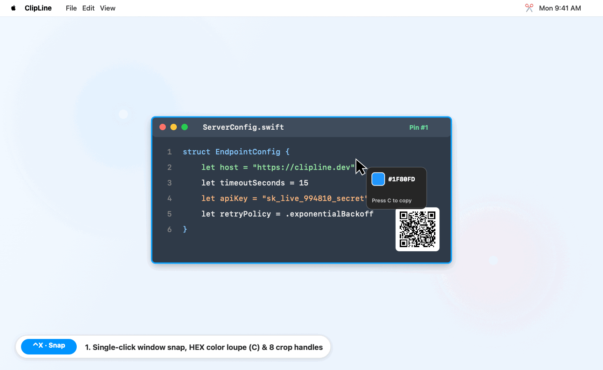
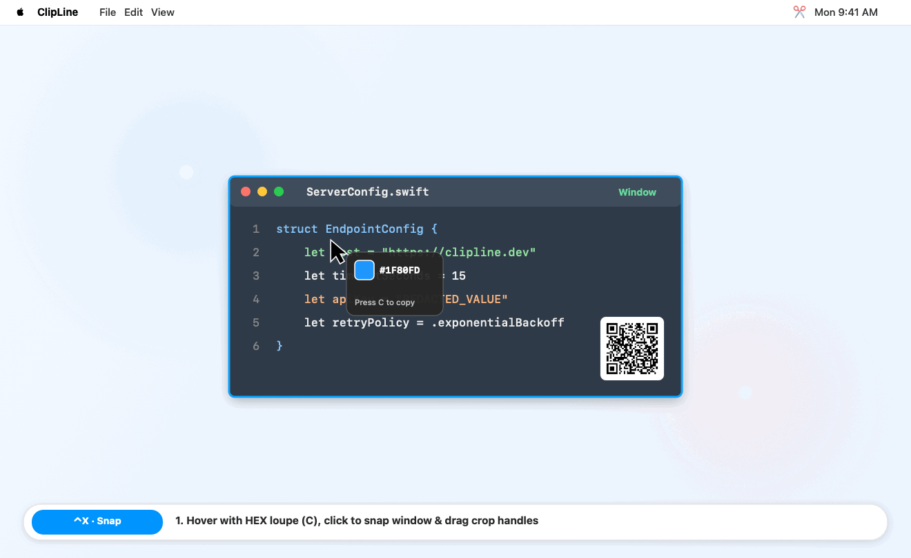
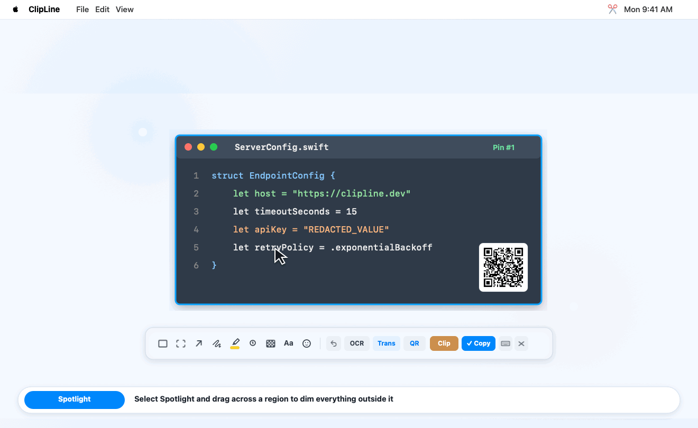
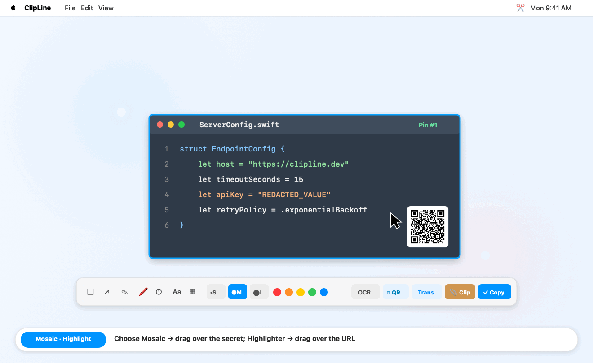
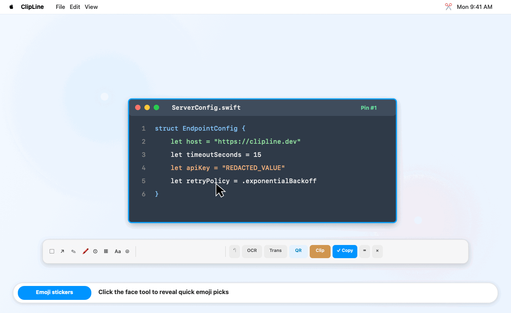
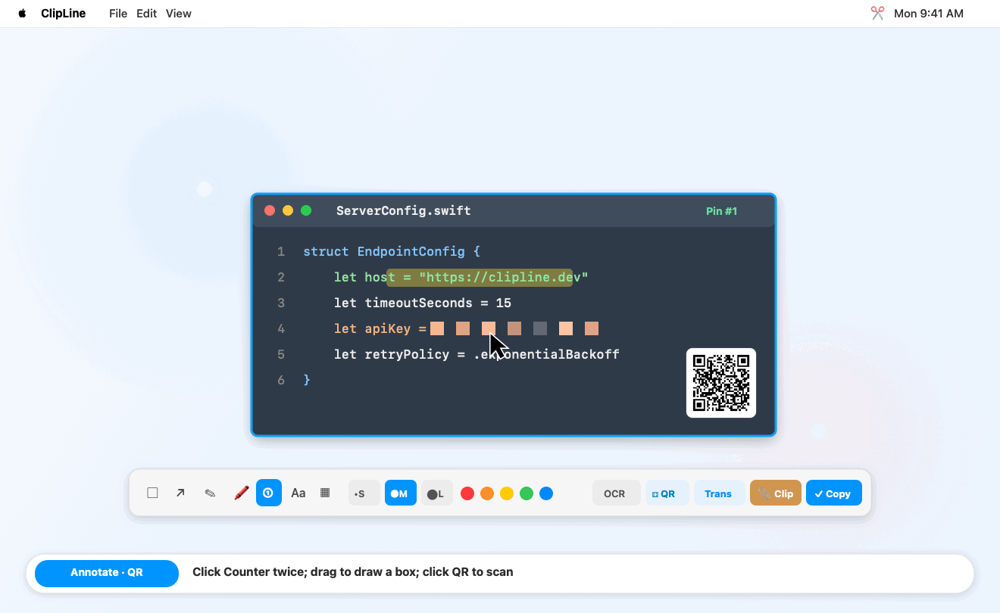
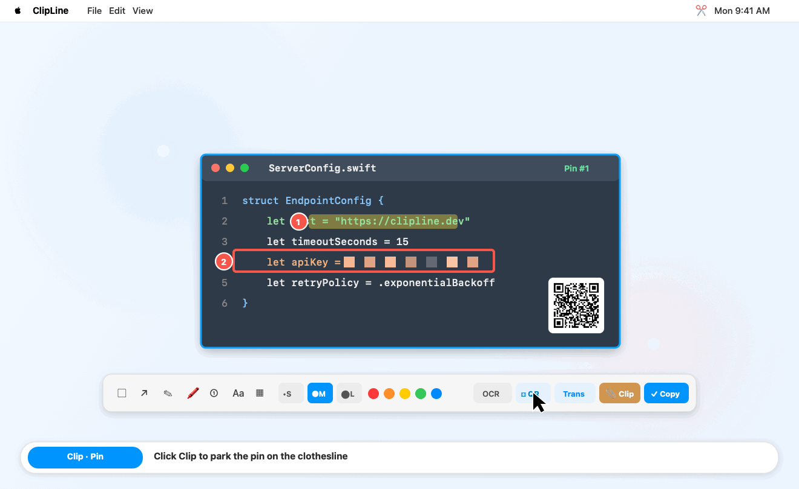
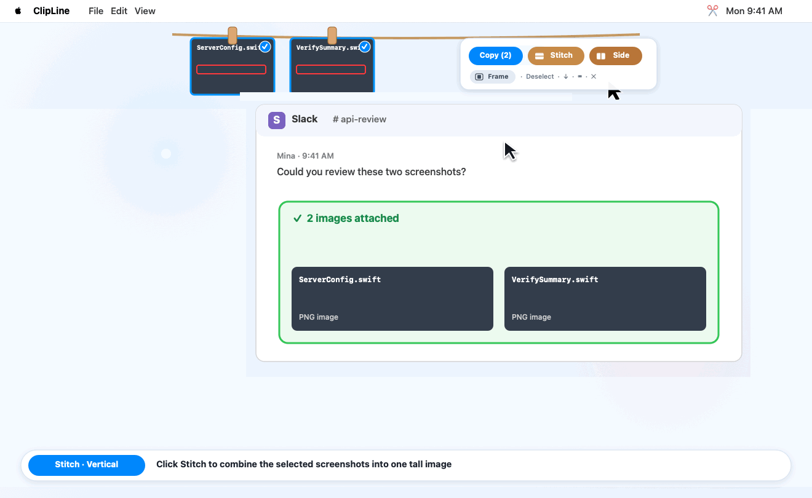
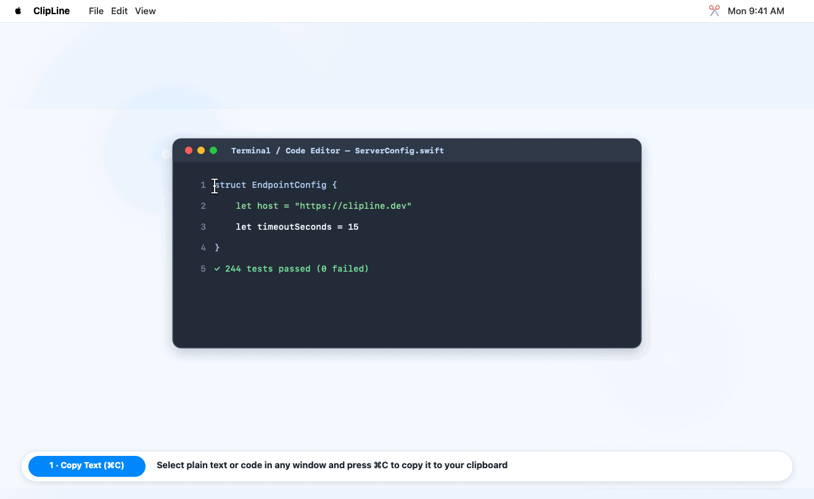

# ClipLine

[](https://github.com/howtospellpizza/ClipLine/actions/workflows/ci.yml)
[](LICENSE)

Capture screenshots, annotate them, and clip them to a floating clothesline at the top of your screen.

[简体中文](README.zh-CN.md)

<p align="center">
  
</p>

```
   ═══════🪵══════════════🪵══════════════🪵═══════
       ┌──────┐       ┌──────┐       ┌──────┐
       │ #1   │       │ #2   │       │ #3   │
       └──────┘       └──────┘       └──────┘
```

## Table of Contents

- [Core Features & Visual Tour](#core-features--visual-tour)
  - [1. Capture, Window Snap, HEX Color Picker & Crop Adjustment](#1-capture-window-snap-hex-color-picker--crop-adjustment)
  - [2. Pin Canvas & 9 Annotation Tools](#2-pin-canvas--9-annotation-tools)
  - [3. Offline OCR, QR/Barcode Auto-Copy & Translation](#3-offline-ocr-qrbarcode-auto-copy--translation)
  - [4. Top Clothesline: Park, Multi-Photo Drag, Vertical/Horizontal Stitch & Frame](#4-top-clothesline-park-multi-photo-drag-verticalhorizontal-stitch--frame)
  - [5. Pin Clipboard Image or Plain Text as a Sticky Note (`⌃⌘V`)](#5-pin-clipboard-image-or-plain-text-as-a-sticky-note-v)
- [Installation & Quickstart](#installation--quickstart)
  - [Install from Source](#install-from-source)
  - [Install with an AI Coding Agent](#install-with-an-ai-coding-agent)
  - [Update & Reinstall](#update--reinstall)
  - [Uninstall](#uninstall)
- [CLI & Keyboard Shortcuts](#cli--keyboard-shortcuts)
- [Permissions, Configuration & Privacy](#permissions-configuration--privacy)
- [Development](#development)

---

## Core Features & Visual Tour

### 1. Capture, Window Snap, HEX Color Picker & Crop Adjustment

Use the global capture shortcut (factory default `⌃X`, secondary `⌘⇧X`):

- **Single-click window snap**: Hover over any visible window (including Stage Manager thumbnails) to preview its bounds, then **single-click** to capture that exact window in one step.
- **Freehand drag & full-screen capture**: Click and drag anywhere to select a custom region, or press `Space` / `⌘A` inside the capture overlay to capture the entire screen immediately.
- **Magnifier & HEX color picker**: Hover to inspect pixel coordinates and the `8×` magnifier loupe; press `C` during capture to copy the hovered pixel's `#RRGGBB` HEX color and exit capture, or customize crosshair style (`Full-Screen Lines`, `Corner Bracket`, `Precision Dot`) and color in **Keyboard Shortcuts** (`⌘,`).
- **Non-destructive crop adjustment**: Before moving the pin or selecting a drawing tool (at `100%` zoom), drag any of the 8 handles or 4 edges to expand or shrink the crop against the original full-screen frame.

<details>
<summary>🎬 <b>Watch demo: Single-click window snap, 8× HEX loupe & edge crop adjustment</b></summary>
<br>
<p align="center">
  
</p>
</details>

---

### 2. Pin Canvas & 9 Annotation Tools

Every captured screenshot stays pinned at its exact screen coordinates. Use the floating toolbar below the pin to annotate, move, scale, or recolor any element (`⌘Z` undoes any step):

| Tool | Highlights |
| :--- | :--- |
| **Rectangle & Arrow** | Hold `Shift` to lock a `1:1` square or snap arrows to `45°` increments; 3 stroke sizes (`S` / `M` / `L`) and 6 colors. |
| **Spotlight (`viewfinder.rectangular`)** | Drag across a focus area to dim everything outside it (`56%` dark mask with crisp white border). Multiple spotlights share one unified backdrop; click a spotlight and drag any of its **4 corner handles** to resize. |
| **Pen & Highlighter** | Smooth freehand drawing and translucent `.multiply`-blend highlighter that never obscures underlying text. |
| **Step Counter (`① ② ③…`)** | Auto-incrementing numbered badges; drag any of the 4 corner handles on a selected badge to scale it smoothly. |
| **Mosaic (`CIPixellate`)** | Pixelates sensitive areas in place. |
| **Text (`Aa`)** | Supports transparent, black pill, or white pill backgrounds; double-click committed text to edit in place, or drag its 4 corner handles to scale font size smoothly. |
| **Emoji Sticker (`😊`)** | One-click quick emoji bar plus macOS Character Palette (`⌃⌘Space`); drag the 4 corner handles to scale any placed sticker. |

<details open>
<summary>🎬 <b>Watch demo: Spotlight focus mask & 4-corner resize handles</b></summary>
<br>
<p align="center">
  
</p>
</details>

<details>
<summary>🎬 <b>Watch demo: Mosaic redaction & multiply-blend highlighter</b></summary>
<br>
<p align="center">
  
</p>
</details>

<details>
<summary>🎬 <b>Watch demo: Quick emoji stickers, Character Palette & corner scaling</b></summary>
<br>
<p align="center">
  
</p>
</details>

---

### 3. Offline OCR, QR/Barcode Auto-Copy & Translation

- **Offline OCR (`O`)**: Recognizes Simplified Chinese, Traditional Chinese, and English offline via macOS `Vision` and copies the extracted text directly to your clipboard.
- **QR / Barcode Scan (`Q`)**: Decodes QR codes and barcodes offline via `VNDetectBarcodesRequest`, **immediately copies all decoded payloads to your clipboard**, and prompts (`Keep Copied Only` / `Open in Browser`) before opening any detected `http`/`https` link.
- **Translate (`T`)**: Runs OCR on the composited image and routes text to:
  1. Local translation daemon (`gloss-daemon`, or custom name via `CLIP_LINE_TRANSLATE_DAEMON`)
  2. Custom URL template (`CLIP_LINE_TRANSLATE_URL`)
  3. macOS system Translation service
  4. Browser translation (prompts once per destination domain before opening)

<details open>
<summary>🎬 <b>Watch demo: Step counters, callouts & QR code auto-copied to clipboard</b></summary>
<br>
<p align="center">
  
</p>
</details>

---

### 4. Top Clothesline: Park, Multi-Photo Drag, Vertical/Horizontal Stitch & Frame

Press `P` / `Tab` (or click **Clip**) to hang the current pin on the floating clothesline at the top of your screen (double-click any thumbnail to unclip it back to the canvas):

- **Multi-photo drag & drop**: Drag a selected thumbnail to drag **all currently selected photos** together (or drag an unselected thumbnail to export just that one) directly into Slack, WeChat, a browser, or Finder. Drag the top rope to reposition the clothesline bar.
- **Batch Copy, Vertical Stitch (`Stitch`) & Horizontal Stitch (`Side`)**: Select 2+ thumbnails and click **Copy** (or **Save**) to export them separately, **Stitch** to combine them top-to-bottom, or **Side** to combine them left-to-right into a single Retina-sharp image.
- **Framed backdrop (`Frame`)**: Toggle **Frame** on the bottom row of the clothesline controls to wrap the next copied or stitched image in a dark gradient card with rounded corners, inner item shadows, and even spacing.

<details>
<summary>🎬 <b>Watch demo: Park pins on the clothesline & drag multiple photos into Slack</b></summary>
<br>
<p align="center">
  
</p>
</details>

<details open>
<summary>🎬 <b>Watch demo: Vertical Stitch, horizontal Side stitch & Framed padding</b></summary>
<br>
<p align="center">
  
</p>
</details>

---

### 5. Pin Clipboard Image or Plain Text as a Sticky Note (`⌃⌘V`)

Press `⌃⌘V` (or run `~/.local/bin/clipline --clipboard`):

- **If the clipboard contains an image**: Pins the image directly on screen.
- **If the clipboard contains plain text or code**: Renders the copied text into a Retina **yellow sticky note Pin** (up to 60 lines with automatic truncation indicator), complete with the full annotation toolbar, OCR/translation, and clothesline parking.

<details open>
<summary>🎬 <b>Watch demo: Copy text (<code>⌘C</code>) → press <code>⌃⌘V</code> to pin as an annotatable sticky note</b></summary>
<br>
<p align="center">
  
</p>
</details>

---

## Installation & Quickstart

### Prerequisites

- macOS 14+ deployment target configured (runtime-tested on the maintainer's current machine; macOS 14/Intel runtime compatibility is not independently verified).
- Swift 5.9+ command-line tools (`xcode-select --install`). If prompted, complete installation and wait for the installer to finish before proceeding.

### Install from Source

```bash
git clone https://github.com/howtospellpizza/ClipLine.git
cd ClipLine
make install
nohup ~/.local/bin/clipline >"$HOME/Library/Logs/clipline.log" 2>&1 &
```

> **Note**: This starts `clipline` in the background for the current session. It does not automatically register a login item or guarantee launch on system startup.

Click the keyboard icon (`⌨️`) on any pin toolbar (or press `⌘,` on a pin window, or run `~/.local/bin/clipline --settings`) to view or edit all global shortcuts. Factory defaults: `⌃X` captures a region, `⌘⇧X` is the secondary capture shortcut, and `⌃⌘V` pins the clipboard image or plain text.

### Install with an AI Coding Agent

Paste this prompt into Claude Code, OpenCode, Cursor, or Codex:

```text
Install ClipLine from https://github.com/howtospellpizza/ClipLine by following its README:
1. Check that macOS 14+ and Swift 5.9+ command-line tools (`swiftc --version`) are available.
2. If an existing `~/.local/bin/clipline` binary, running `clipline` process, or checkout is present, ask before overwriting, uninstalling, or deleting anything.
3. Clone the repository, run `make install`, and start the background daemon (`nohup ~/.local/bin/clipline >"$HOME/Library/Logs/clipline.log" 2>&1 &`). Do not register a LaunchAgent or login item unless asked.
4. Verify the install by running `~/.local/bin/clipline --help`, `~/.local/bin/clipline --shortcuts`, and checking `pgrep -x clipline` plus `$HOME/Library/Logs/clipline.log`.
5. Remind me to grant Screen Recording permission in System Settings -> Privacy & Security -> Screen & System Audio Recording and test one capture (`⌃X`), since macOS TCC approval requires manual user interaction.
```

### Update & Reinstall

Update the executable you invoked from the latest official `main` branch:

```bash
~/.local/bin/clipline --update
```

The updater downloads a fresh temporary checkout, builds before replacing the currently invoked executable, and does not modify a local repository checkout. It contacts GitHub to fetch public source; ClipLine does not upload screenshots, clipboard contents, or preferences.

- A certificate-signed install is updated only when its signing identity is available. Otherwise, the update stops before replacing the binary and gives instructions; it never removes macOS permission settings. Ad-hoc builds may require Screen Recording reapproval.
- If an already registered LaunchAgent targets this exact executable, the updater restarts that job and never creates one. Otherwise, it restarts only a running daemon at the same executable path, using the updater's current environment. Environment overrides unique to the old process cannot be recovered.
- Active pins are unsaved and may be lost when the daemon restarts. Save anything important before updating. If no matching daemon or LaunchAgent is running, the updater leaves the app stopped.

`make install` is a local build-and-copy operation only: it builds `build/clipline` and copies it to `~/.local/bin/clipline`. It does not sign the binary, stop or restart a daemon, or register/manage a LaunchAgent. To update from a local checkout instead:

```bash
cd /path/to/ClipLine
git pull --ff-only
make build
make install
```

- If `git pull --ff-only` fails due to local changes, resolve your working tree before updating.
- Restart the daemon manually after saving active pins; `make install` does not restart it.
- `clipline --update` is a CLI command; `make update`, `make version`, and service-management Make targets do not exist.

### Uninstall

```bash
make uninstall
```

- Removes the installed binary (`~/.local/bin/clipline`) and stops the current user's process at that exact installed path, not copies elsewhere.
- Unloads and removes the daemon LaunchAgent (`~/Library/LaunchAgents/io.github.clipline.daemon.plist`) if present.
- Unsaved active pins and images parked on the clothesline are lost; PNGs already saved to disk are not removed.
- Preserves preferences (`defaults`) and macOS TCC permission entries.

---

## CLI & Keyboard Shortcuts

### CLI Commands

Use the full path `~/.local/bin/clipline` unless `~/.local/bin` is in your `PATH`:

```bash
~/.local/bin/clipline --capture     # start interactive region capture
~/.local/bin/clipline --clipboard   # pin current clipboard image (or plain text as a sticky note)
~/.local/bin/clipline --settings    # open shortcut settings (starts the daemon if needed)
~/.local/bin/clipline --shortcuts   # print current global shortcuts as JSON
~/.local/bin/clipline --doctor      # print read-only local diagnostic report (add --json for JSON)
~/.local/bin/clipline --version     # print ClipLine version and target architecture
~/.local/bin/clipline --update      # update the invoked executable from official main
```

The capture and clipboard commands trigger a running daemon. Shortcut settings persist in the `io.github.clipline` UserDefaults suite.
Carbon's exclusive registration detects conflicts with other exclusive Carbon hotkeys, but cannot detect every macOS, system, or app shortcut. If a binding does not work in a particular app, choose another one.

### Keyboard Shortcuts

The table lists factory defaults; use **Keyboard Shortcuts** (`⌘,`) or `clipline --shortcuts` for your current bindings.

| Factory default | Context | Action |
| :--- | :--- | :--- |
| `⌃X` | Global | Capture region |
| `⌘⇧X` | Global | Capture region (secondary shortcut) |
| `⌃⌘V` | Global | Pin image (or plain text as a sticky note) from clipboard |
| `Space` / `⌘A` | Capture overlay | Capture full screen immediately |
| `C` | Capture overlay | Copy hovered pixel `#RRGGBB` HEX color and exit capture |
| `↩` (`Return`) | Active pin | Copy composited image and close pin |
| `⌘C` | Active pin | Copy composited image (keep pin open) |
| `⌘S` | Active pin | Save as PNG |
| `P` / `⇥` (`Tab`) | Active pin | Hang pin on the clothesline |
| `O` | Active pin | Copy OCR text |
| `Q` | Active pin | Scan QR code / barcode and copy payload |
| `T` | Active pin | Run OCR and translate |
| `⌫` / `Delete` | Active pin | Delete selected annotation |
| `Space` | Active pin | Toggle toolbar |
| `⌘Z` | Active pin | Undo last annotation |
| `+` / `-` | Active pin | Zoom (`35%` – `300%`) |
| `⌥` + Scroll | Active pin | Adjust opacity (`25%` – `100%`) |
| `⎋` (`Esc`) | Capture / Pin | Cancel capture, cancel text edit, or close pin without modifying the clipboard |

---

## Permissions, Configuration & Privacy

### Permissions

On first capture, macOS prompts for **Screen Recording** permission. The prompt may appear either for `clipline` or for your host terminal application (e.g., Terminal or iTerm2):

1. Open **System Settings → Privacy & Security → Screen & System Audio Recording**.
2. Enable `clipline` (or your terminal application if prompted).
3. Restart the `clipline` process after granting permissions so the changes take effect.

> **Note**: The updater reuses the existing certificate signing identity and identifier when available. Ad-hoc builds may require re-approving Screen Recording in System Settings after an update.

### Configuration

| Variable / Key | Default | Description |
| :--- | :--- | :--- |
| `CLIP_LINE_LANG` | Auto (`Locale.preferredLanguages`) | UI language override (`en` or `zh-Hans`) |
| `CLIP_LINE_TRANSLATE_TARGET` | `en` (EN UI) / `zh-CN` (ZH UI) | Target language code (`tl`) for built-in web translation fallback |
| `CLIP_LINE_TRANSLATE_URL` | Unset | Custom HTTPS (or `localhost` HTTP) URL template using `{text}` placeholder |
| `TranslateURLTemplate` (`NSGlobalDomain`) | Unset | Persistent `defaults write` equivalent of `CLIP_LINE_TRANSLATE_URL` |
| `CLIP_LINE_TRANSLATE_DAEMON` | `gloss-daemon` | Process name checked for local translation routing |
| `CLIP_LINE_TRANSLATE_CHANNEL` | `io.github.clipline.translate` | Distributed notification channel for local translation |
| `CLIP_LINE_CAPTURE_CHANNEL` | `io.github.clipline.capture` | Distributed notification channel for external capture triggers |

Example custom translation URL:

```bash
export CLIP_LINE_TRANSLATE_URL="https://www.deepl.com/translator#en/zh/{text}"
```

### Privacy & Security Notes

- **Mosaic is visual obfuscation**: Uses `CoreImage` `CIPixellate` (and falls back to an opaque dark fill if pixelation fails). For sensitive credentials or keys, crop them out or cover them with an opaque pen stroke.
- **Temporary files**: Writes `ClipLine_*.png` to `$TMPDIR/ClipLine` (`0700`) so file-paste and drag-and-drop work across Finder and chat apps. Files older than 1 hour are removed on daemon startup and on subsequent copy actions.
- **Local notifications**: When `gloss-daemon` is running, OCR text is posted via `DistributedNotificationCenter` within the current macOS user session.

---

## Development

```bash
make build                    # compile release binary to ./build/clipline
make test                     # run all 9 unit & AppKit suites (isolated pasteboard & temp directory)
make test FILTER="Suite 5"    # run only matching test suite(s)
make test-install             # check scoped uninstall and reinstall in an isolated directory
make uninstall                # stop daemon and remove ~/.local/bin/clipline
make clean                    # remove ./build
```

## License

[MIT](LICENSE)
