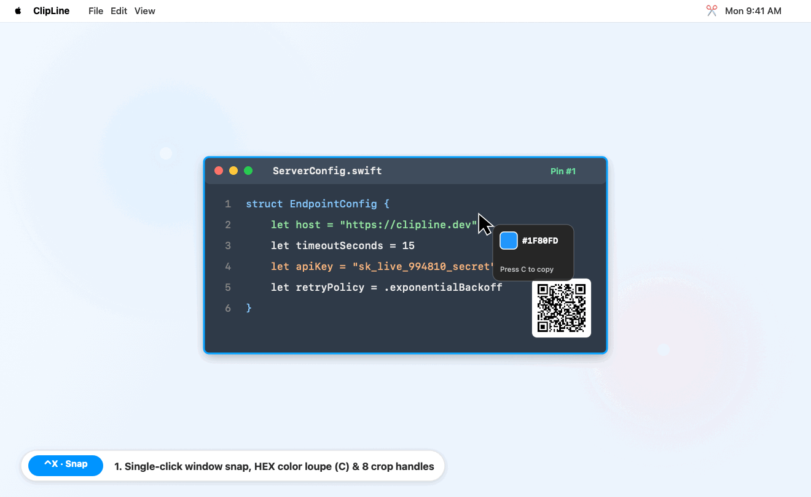
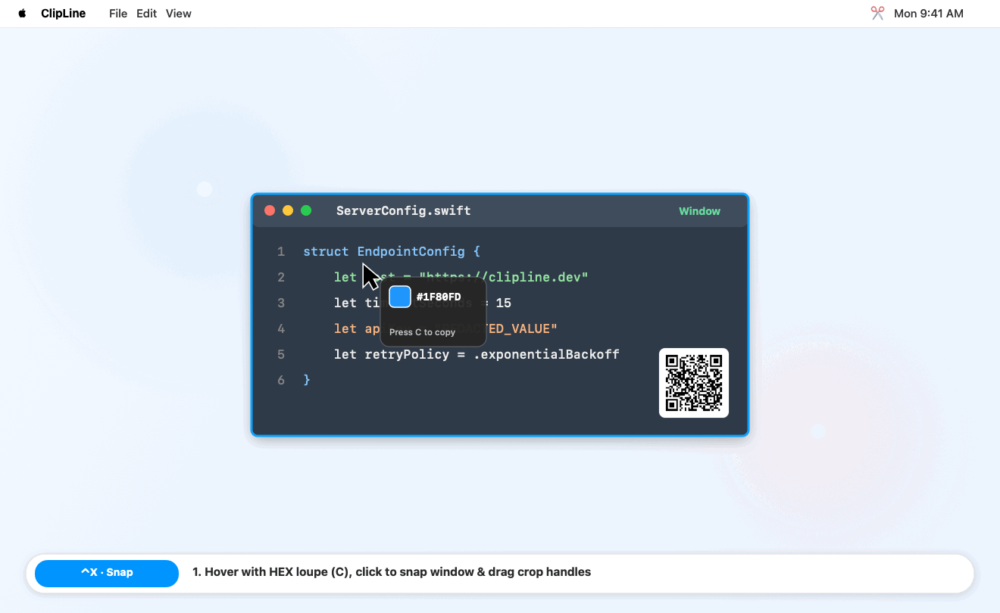
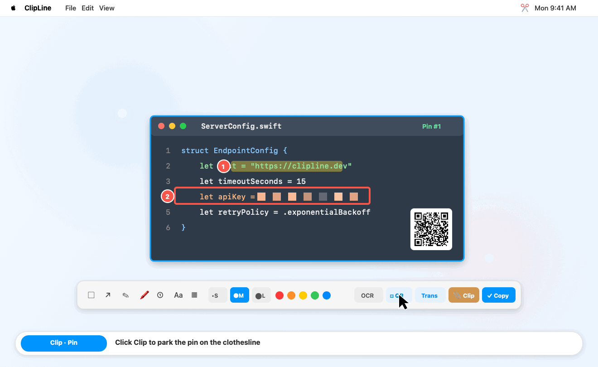
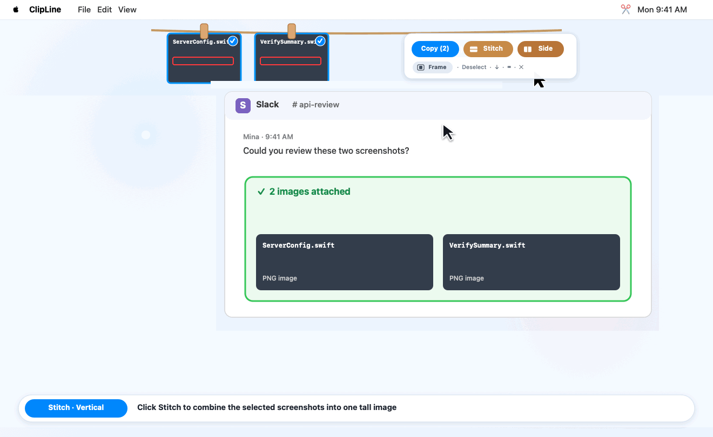
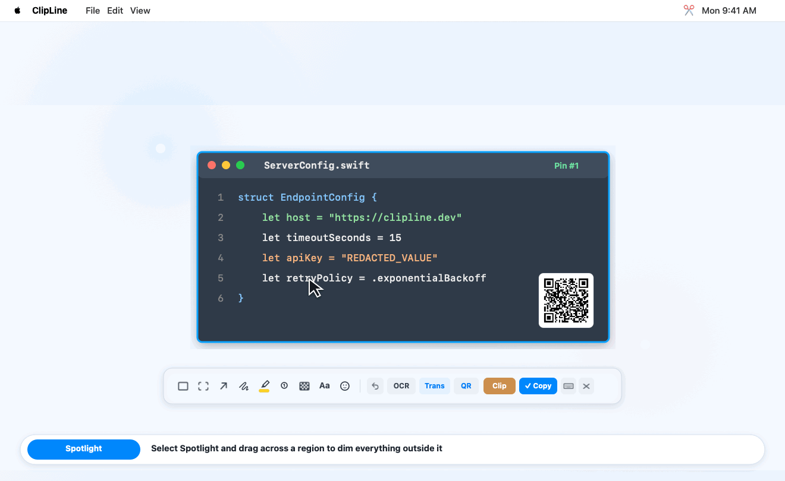
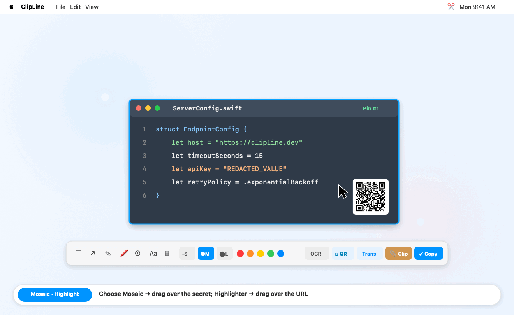
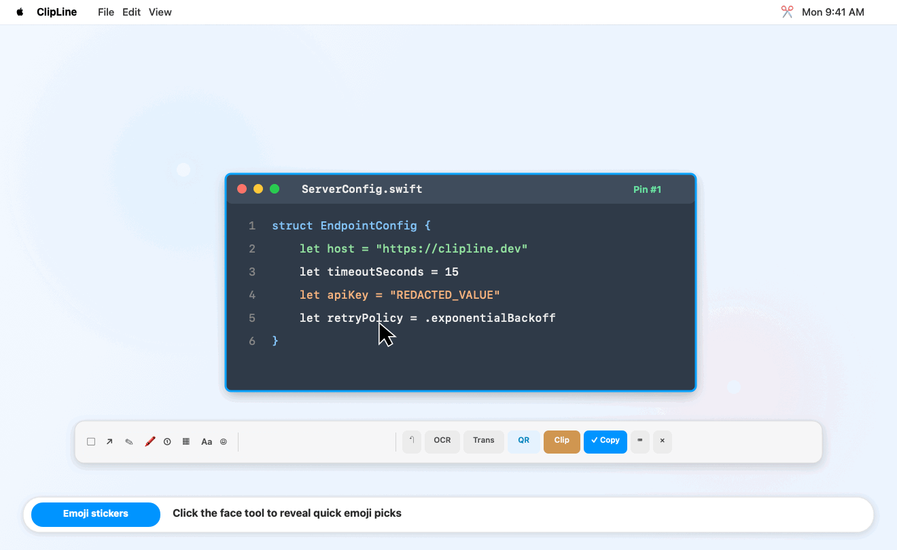
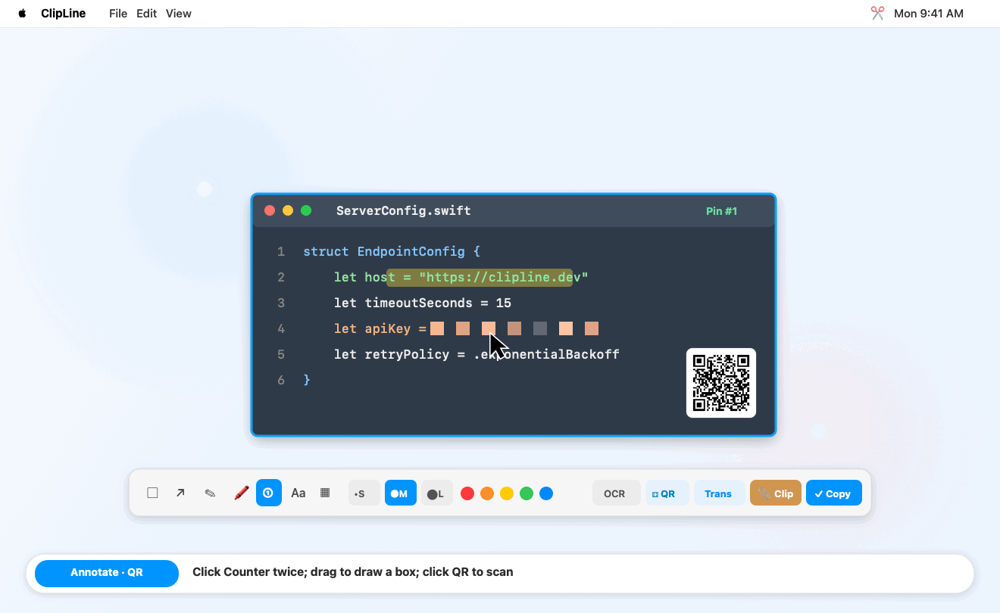
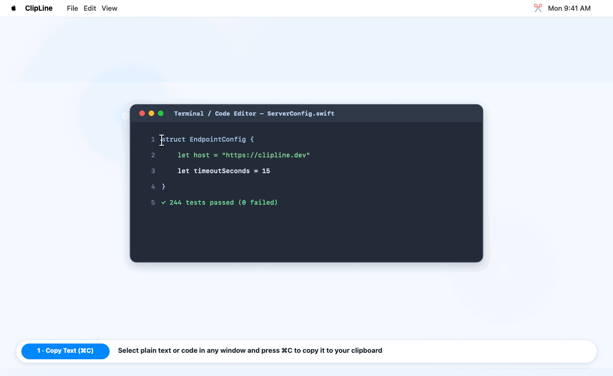

# ClipLine

[](https://github.com/howtospellpizza/ClipLine/actions/workflows/ci.yml)
[](LICENSE)

macOS 原生截图、标注与顶部“晾衣绳”贴图工具。

[English](README.md)

<p align="center">
  
</p>

```
   ═══════🪵══════════════🪵══════════════🪵═══════
       ┌──────┐       ┌──────┐       ┌──────┐
       │ #1   │       │ #2   │       │ #3   │
       └──────┘       └──────┘       └──────┘
```

## 安装与快速开始

### 前置要求

- 项目配置了 macOS 14+ 部署目标（已在维护者当前机器上通过运行时验证；macOS 14 与 Intel 架构运行兼容性未经独立完整验证）。
- Swift 5.9+ 命令行工具（`xcode-select --install`）。如弹出安装提示，请等待工具安装完成后再继续。

### 源码安装

```bash
git clone https://github.com/howtospellpizza/ClipLine.git
cd ClipLine
make install
nohup ~/.local/bin/clipline >"$HOME/Library/Logs/clipline.log" 2>&1 &
```

> **注意**：该命令会在当前会话后台启动 `clipline`，不会自动注册登录项，亦不保证开机自启。

点击截图工具栏右侧的键盘图标 `⌨️`（或在贴图窗口按 `⌘,`，或运行 `~/.local/bin/clipline --settings`），即可查看或编辑全部全局快捷键。出厂默认值：`⌃X` 框选截图，`⌘⇧X` 为备用截图快捷键，`⌃⌘V` 将剪贴板图片贴到屏幕上。

### 让 AI 助手帮你安装

将以下提示词复制给 Claude Code、OpenCode、Cursor 或 Codex：

```text
请参照仓库 README 帮我安装 ClipLine（https://github.com/howtospellpizza/ClipLine）：
1. 检查当前环境是否满足 macOS 14+ 与 Swift 5.9+ 命令行工具（`swiftc --version`）。
2. 若检测到已有 `~/.local/bin/clipline`、正在运行的 `clipline` 进程或本地仓库修改，请先向我确认，不要直接覆盖、卸载或删除。
3. 克隆仓库并执行 `make install`，随后在后台启动守护进程（`nohup ~/.local/bin/clipline >"$HOME/Library/Logs/clipline.log" 2>&1 &`）。除非我明确要求，不要自动注册 LaunchAgent 或开机登录项。
4. 运行 `~/.local/bin/clipline --help`、`~/.local/bin/clipline --shortcuts`，并检查 `pgrep -x clipline` 与 `$HOME/Library/Logs/clipline.log` 验证安装结果。
5. 提醒我前往「系统设置 → 隐私与安全性 → 录屏与系统录音」手动开启屏幕录制权限，并按一次 `⌃X` 测试截图与复制（macOS TCC 权限无法由脚本自动绕过）。
```

### 更新与重新安装

从官方 `main` 分支更新当前运行的二进制文件：

```bash
~/.local/bin/clipline --update
```

更新器会下载一份全新的临时仓库副本，先完成编译，再替换当前调用的二进制文件，不会修改本地仓库。更新需要连接 GitHub 下载公开源码；ClipLine 不会上传截图、剪贴板内容或偏好设置。

- 如果现有安装使用证书签名，只有在可用原签名身份时才会更新。否则，更新器会在替换二进制文件前停止并给出说明；它不会删除 macOS 权限设置。Ad-hoc 签名的版本更新后可能需要重新授权屏幕录制。
- 如果已注册的 LaunchAgent 确实指向当前二进制文件，更新器会重启该任务，但不会新建 LaunchAgent。否则，只有检测到相同可执行文件路径的守护进程正在运行时，才会停止并重启该进程；新进程使用更新器当前的环境变量，无法恢复仅存在于旧进程中的环境变量。
- 活动贴图尚未保存，守护进程重启时可能丢失。更新前请先保存重要内容。如果没有匹配的运行中守护进程或 LaunchAgent，更新器不会启动应用。

`make install` 仅用于本地编译并复制：它会构建 `build/clipline`，再复制到 `~/.local/bin/clipline`。它不会对二进制文件签名、停止或重启守护进程，也不会注册或管理 LaunchAgent。也可以从本地仓库更新：

```bash
cd /path/to/ClipLine
git pull --ff-only
make build
make install
```

- 若 `git pull --ff-only` 因本地修改报错，请先处理工作区改动后再更新。
- 保存活动贴图后，请手动重启守护进程；`make install` 不会重启它。
- `clipline --update` 是命令行功能；Makefile 中不存在 `make update`、`make version` 或服务管理相关的 target。

### 卸载

```bash
make uninstall
```

- 移除已安装的二进制文件（`~/.local/bin/clipline`），仅停止当前用户在该安装路径运行的进程，不影响其他路径下的副本。
- 卸载并删除 LaunchAgent 文件（`~/Library/LaunchAgents/io.github.clipline.daemon.plist`，如果存在）。
- 未保存的贴图和晾衣绳中的图片会丢失；已保存到磁盘的 PNG 文件不会删除。
- 保留系统偏好设置（`defaults`）与 macOS TCC 权限授权记录。

## 基本用法

### 1. 智能窗口吸附、放大镜取色、原地贴图与裁剪微调

使用已配置的截图快捷键（出厂默认值为 `⌃X`）：
- **单击智能吸附窗口**：鼠标悬停在任意可见窗口（包括台前调度左侧缩略图）上会自动高亮识别边界，**直接单击**即可一键截取完整窗口。
- **拖拽自由框选**：在桌面或任意窗口内按住鼠标拖拽，即可截取自定义区域。
- **一键截全屏**：进入截图模式后按 **`Space`（空格键）** 或 **`⌘A`**，即可直接截取整张屏幕。
- **放大镜与 HEX 取色器**：悬停时实时显示坐标与 `8×` 像素放大镜，按 **`C`** 即可直接复制当前像素的 `#RRGGBB` 色值并退出截图；可在快捷键设置（`⌘,`）中切换准星样式（全屏十字线、四角取景框、极简圆点）与配色。

截图完成后，贴图会直接停留在所选的屏幕坐标处。在移动窗口或选择标注工具前（`100%` 缩放比例下），拖拽四周的 8 个圆点或 4 条边，可基于原始全屏画面继续放大或缩小裁剪范围。

<details>
<summary>🎬 <b>演示：单击窗口智能吸附、HEX 像素取色器与边缘无损重裁</b></summary>
<br>
<p align="center">
  
</p>
</details>

### 2. 晾衣绳多图暂存

按 `P`（或点击工具栏上的木夹图标）把当前贴图挂到屏幕顶部的晾衣绳：

- **多图批量复制、纵/横向拼图、加边距衬底与导出**：在晾衣绳上点选多张缩略图，点击 **复制** 可作为多张独立图片写入剪贴板；点击 **拼长图**（纵向）或 **横向拼**（并排）可将多张图拼接为一张 Retina 原生高清图并复制；开启底部 **加边距** 可在下次复制或拼图时自动加上深色渐变衬底、圆角阴影与间距；也可点击下载图标批量保存到文件夹。
- **多图拖拽导出**：直接按住已选中的缩略图即可**将当前选中的多张图片一起拖入**微信、Slack、浏览器或 Finder（拖未选中的图片则仅导出该张）；按住顶部绳索可自由移动晾衣绳位置。
- **取回编辑**：双击任意缩略图即可取回画布继续编辑。

<details>
<summary>🎬 <b>演示：挂上顶部晾衣绳并一并拖入 Slack 聊天窗口</b></summary>
<br>
<p align="center">
  
</p>
</details>

<details open>
<summary>🎬 <b>演示：纵向拼长图、横向并排拼图（Side）与深色加边距衬底（Frame）</b></summary>
<br>
<p align="center">
  
</p>
</details>

### 3. 标注、OCR、二维码识别与翻译

- **标注工具**：矩形（按住 `Shift` 锁定正方形）、聚光灯遮罩（自动压暗选区外部，多个聚光灯共享同一层暗色背景）、箭头（按住 `Shift` 锁定 `45°` 方向）、画笔、半透明荧光笔（正片叠底不遮字）、自动递增序号章（`① ② ③…`）、像素马赛克（`CIPixellate`）、文字、Emoji 贴图（工具栏快捷表情栏 + macOS「表情与符号」面板 `⌃⌘Space`），适用的工具提供 `细` / `中` / `粗` 三档尺寸与 6 种颜色。
- **选中、移动、无级缩放、改色与删除标注**：点击画布上已绘制的任意矩形、聚光灯、箭头、画笔/荧光笔轨迹、序号章、文字、Emoji 贴图或马赛克区域，即可直接拖拽移动位置、在工具栏切换颜色与粗细、拖拽聚光灯 / 文字 / Emoji / 序号章选中框四角的缩放圆点无级调整大小，或按 `Delete` / `⌫` 删除（支持 `⌘Z` 多步快照撤销）。
- **文字与 Emoji 贴图**：文字支持透明底、黑底圆角、白底圆角背景，输入时按住文字框任意位置即可拖动，双击已提交的文字可原地重编辑，完成编辑后既保留 `细` / `中` / `粗` 预设，也可拖拽选中框四角圆点自由改变字号。Emoji 贴图支持一键点选常用表情或打开 macOS「表情与符号」面板选择任意 Emoji，放置后直接拖拽四角控制点即可自由调节大小。
- **离线 OCR（`O`）**：使用 macOS `Vision` 离线识别简繁中文与英文，并复制到剪贴板。
- **二维码 / 条形码识别（`Q`）**：使用 `VNDetectBarcodesRequest` 离线识别截图中的二维码与条形码，自动复制内容到剪贴板，并在识别到 `http`/`https` 链接时弹窗确认是否在浏览器打开。
- **翻译路由（`T`）**：对合成后的图像执行 OCR，并按以下顺序发送识别文本：
  1. 本地翻译进程（默认检测 `gloss-daemon`，可通过 `CLIP_LINE_TRANSLATE_DAEMON` 指定）
  2. 自定义翻译 URL 模板（`CLIP_LINE_TRANSLATE_URL`）
  3. macOS 系统翻译服务
  4. 默认浏览器网页翻译（每个外部域名首次打开前会弹窗确认）

<details open>
<summary>🎬 <b>演示：聚光灯（Spotlight）重点遮罩与四角无级缩放</b></summary>
<br>
<p align="center">
  
</p>
</details>

<details>
<summary>🎬 <b>演示：像素马赛克打码与正片叠底荧光笔</b></summary>
<br>
<p align="center">
  
</p>
</details>

<details>
<summary>🎬 <b>演示：快捷 Emoji 贴图、系统表情面板与四角无级缩放</b></summary>
<br>
<p align="center">
  
</p>
</details>

<details>
<summary>🎬 <b>演示：递增序号章、框选/箭头标注与离线二维码识别</b></summary>
<br>
<p align="center">
  
</p>
</details>

### 4. 命令行触发

除非已将 `~/.local/bin` 加入 `PATH`，请使用完整路径 `~/.local/bin/clipline`：

```bash
~/.local/bin/clipline --capture     # 启动框选截图
~/.local/bin/clipline --clipboard   # 将剪贴板中的图片（或纯文本便签卡片）贴到屏幕上
~/.local/bin/clipline --settings    # 打开快捷键设置（必要时启动守护进程）
~/.local/bin/clipline --shortcuts   # 以 JSON 输出当前全局快捷键
~/.local/bin/clipline --update      # 从官方 main 更新当前调用的二进制文件
```

<details open>
<summary>🎬 <b>演示：将剪贴板纯文本一键贴成可标注的 Retina 便签卡片（<code>⌃⌘V</code> / <code>--clipboard</code>）</b></summary>
<br>
<p align="center">
  
</p>
</details>

截图与剪贴板命令会触发正在运行的守护进程。快捷键设置保存在 `io.github.clipline` UserDefaults 套件中。
Carbon 独占注册只能检测其他使用独占 Carbon 注册的快捷键冲突，无法识别所有 macOS、系统或应用快捷键。如果某个快捷键在特定应用中不起作用，请改用其他组合。

## 快捷键

下表列出出厂默认值；请在**键盘快捷键**设置中查看当前绑定，或运行 `clipline --shortcuts`。

| 出厂默认值 | 场景 | 功能 |
| :--- | :--- | :--- |
| `⌃X` | 全局 | 框选截图 |
| `⌘⇧X` | 全局 | 框选截图（备用快捷键） |
| `⌃⌘V` | 全局 | 将剪贴板图片（或纯文本便签）贴到屏幕 |
| `Space` / `⌘A` | 截图模式 | 一键截取全屏 |
| `C` | 截图模式 | 复制当前悬停像素的 `#RRGGBB` 色值并退出截图 |
| `↩` (`Return`) | 贴图窗口 | 复制合成图片并关闭贴图 |
| `⌘C` | 贴图窗口 | 复制合成图片（保留贴图窗口） |
| `⌘S` | 贴图窗口 | 保存为 PNG |
| `P` / `⇥` (`Tab`) | 贴图窗口 | 挂到顶部晾衣绳 |
| `O` | 贴图窗口 | OCR 识别文字并复制 |
| `Q` | 贴图窗口 | 识别二维码 / 条形码并复制 |
| `T` | 贴图窗口 | OCR 识别并翻译 |
| `⌫` / `Delete` | 贴图窗口 | 删除当前选中的标注 |
| `Space` | 贴图窗口 | 显示 / 隐藏工具栏 |
| `⌘Z` | 贴图窗口 | 撤销上一步标注 |
| `+` / `-` | 贴图窗口 | 缩放贴图（`35%` – `300%`） |
| `⌥` + 滚轮 | 贴图窗口 | 调节透明度（`25%` – `100%`） |
| `⎋` (`Esc`) | 选区 / 贴图 | 取消截图、退出文字编辑或关闭贴图（不修改剪贴板） |

## 权限设置

首次截图时，macOS 会请求 **屏幕录制** 权限。授权提示可能针对 `clipline` 或你当前使用的终端软件（如 Terminal、iTerm2）：

1. 打开 **系统设置 → 隐私与安全性 → 录屏与系统录音**。
2. 勾选启用 `clipline`（若提示的是终端软件，则启用对应的终端）。
3. 授权后请重启 `clipline` 进程，使权限变更生效。

> **注意**：更新器会在可用时复用现有证书签名身份与标识。Ad-hoc 签名的版本更新后，可能需要在系统设置中重新授权屏幕录制。

## 配置项

| 环境变量 / 配置键 | 默认值 | 说明 |
| :--- | :--- | :--- |
| `CLIP_LINE_LANG` | 自动跟随系统语言 | 界面语言覆盖（支持 `en` 或 `zh-Hans`） |
| `CLIP_LINE_TRANSLATE_TARGET` | `zh-CN`（中文界面）/ `en`（英文界面） | 内置网页翻译的目标语言代码（`tl` 参数） |
| `CLIP_LINE_TRANSLATE_URL` | 未设置 | 自定义 HTTPS（或 `localhost` HTTP）翻译 URL 模板，使用 `{text}` 占位符 |
| `TranslateURLTemplate` (`NSGlobalDomain`) | 未设置 | `CLIP_LINE_TRANSLATE_URL` 的 `defaults write` 持久化配置项 |
| `CLIP_LINE_TRANSLATE_DAEMON` | `gloss-daemon` | 本地翻译守护进程名 |
| `CLIP_LINE_TRANSLATE_CHANNEL` | `io.github.clipline.translate` | 本地翻译分布式通知通道 |
| `CLIP_LINE_CAPTURE_CHANNEL` | `io.github.clipline.capture` | 外部触发截图的分布式通知通道 |

配置自定义翻译网址示例：

```bash
export CLIP_LINE_TRANSLATE_URL="https://www.deepl.com/translator#en/zh/{text}"
```

## 开发与测试

```bash
make build      # 编译 Release 二进制文件到 ./build/clipline
make test       # 运行单元与 AppKit 回归检查（使用独立快捷键设置、剪贴板与临时目录）
make test-install # 在隔离目录中验证卸载与重装流程
make uninstall  # 停止守护进程并移除 ~/.local/bin/clipline
make clean      # 清理 ./build
```

## 隐私与安全说明

- **马赛克属于视觉遮挡**：使用 `CoreImage` 的 `CIPixellate` 像素化（若渲染异常则回退为不透明深色实心块）。如需处理密钥或密码等高敏感内容，请直接裁剪剔除或使用不透明画笔覆盖。
- **临时文件**：为支持 Finder/Slack 文件粘贴与拖拽导出，程序会在 `$TMPDIR/ClipLine`（权限 `0700`）写入 `ClipLine_*.png`。超过 1 小时的旧文件会在进程启动和后续复制时清理。
- **本地通知**：当检测到 `gloss-daemon` 运行时，OCR 文本会通过当前登录用户会话内的 `DistributedNotificationCenter` 发送。

## 许可证

[MIT](LICENSE)
